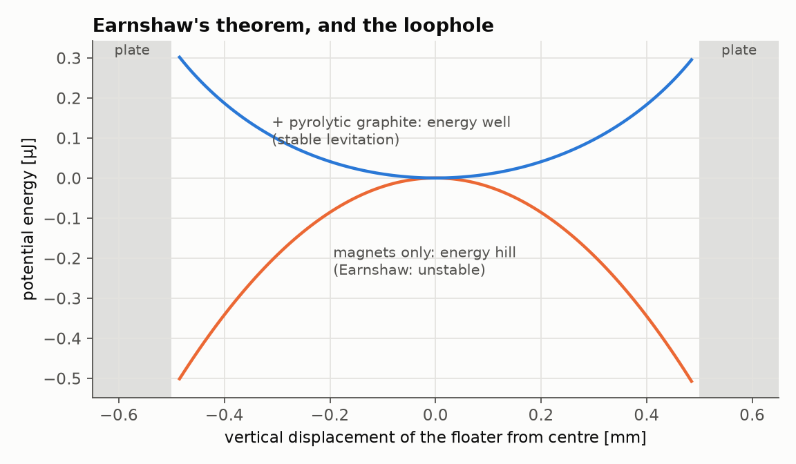
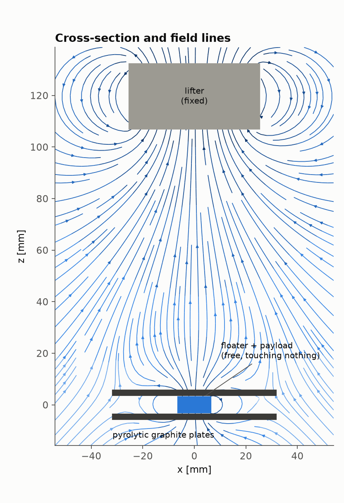
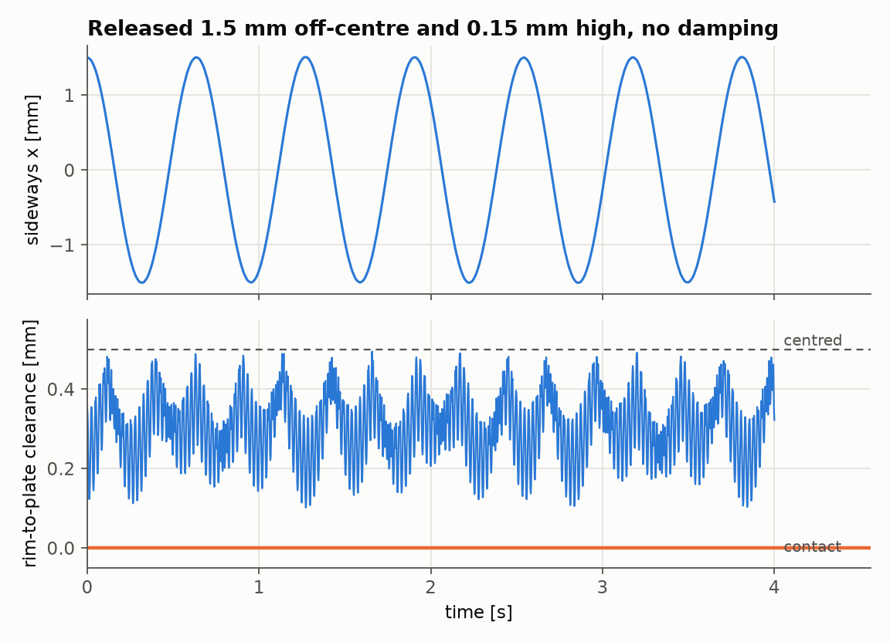
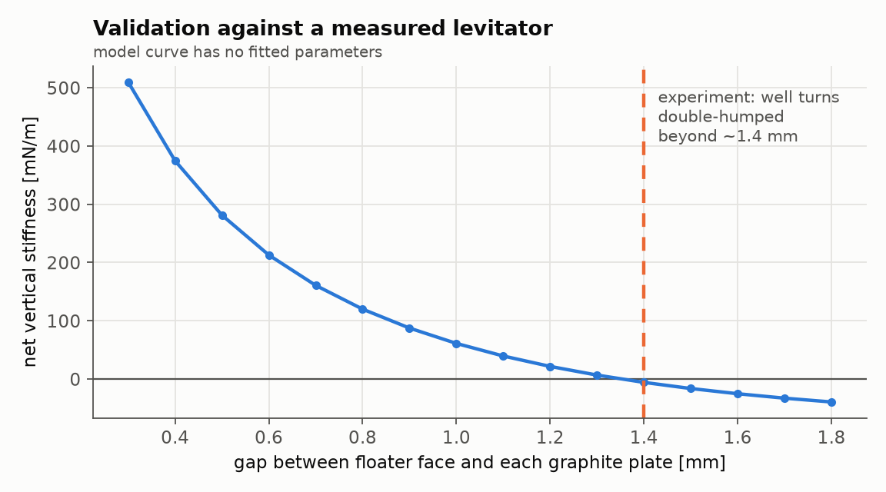
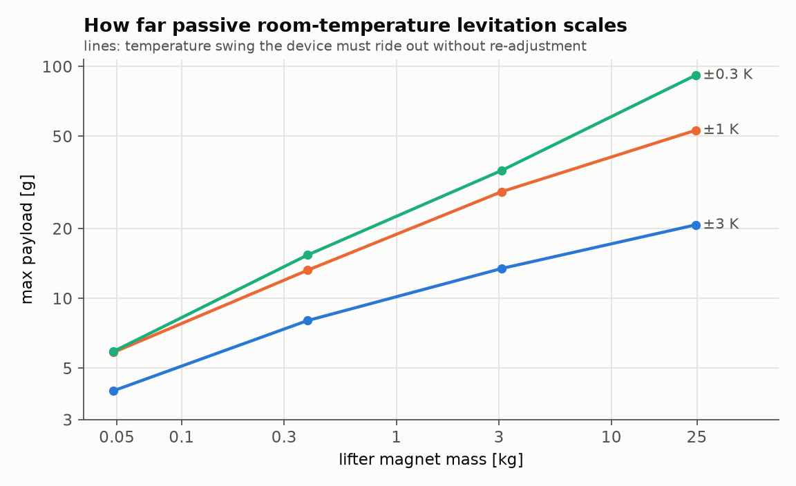

# Porto: an honest attempt at an anti-gravity device

**Goal:** invent an anti-gravity device.

**Result:** every route to *true* anti-gravity that I could find is ruled out by experiment, by 7 to 18
orders of magnitude (§1). What physics does allow is cancelling an object's weight with a field
anchored to the ground, **with nothing touching the object, no power supply, no cryogenics and no
moving parts**. This repo designs that device, models it from first principles, validates the model
against a published measurement, and optimises it for payload under real-world tolerances.

The device, the **Loophole Levitator**, floats a 6 g magnet plus **7.6 g of payload** indefinitely at room
temperature. It uses one stock 2″ × 1″ NdFeB magnet, one ½″ × ¼″ NdFeB disc and two pyrolytic-graphite
plates. It is a design and a simulation: nothing has been built yet.

<p align="center"></p>

---

## 1. The graveyard: what I tried first

Each idea was sized with published experimental limits, and every assumption was set to favour the idea.
The code is `loophole/graveyard.py` (`python -m loophole.graveyard`).

| Idea | Best case, in numbers | Verdict |
|---|---|---|
| **Gravity shielding** (a "Faraday cage" for gravity; Majorana, Podkletnov) | Lunar laser ranging bounds absorption to ≲10⁻²¹ m²/kg. Cutting a weight by 1 % would take a shield of ~10¹⁹ kg/m², a stack of **~10⁸ Earths**. 1 m of lead reduces weight by ≤10⁻¹⁷. Podkletnov's 2 % claim: null to 10⁻⁵ in replication. | Dead |
| **Negative mass / antimatter** | Antihydrogen falls **down** at (0.75 ± 0.13 ± 0.16) g (ALPHA-g, 2023), which excludes "falls up" at ~8σ. No material changes its free-fall rate by more than ~4 × 10⁻¹⁵ (MICROSCOPE). Even hypothetical negative mass would fall down. A repulsor pushing at 1 g from 1 m would need **1.5 × 10¹¹ kg** of it. | Dead |
| **Casimir vacuum energy** as that repulsor | −4.3 × 10⁴ J/m³ at a 10 nm gap, i.e. −5 × 10⁻¹³ kg/m³. It would take **~280 Earth volumes** of cavities, and the plates outweigh the negative energy by ~10¹⁴ even if they are single graphene sheets. | Dead |
| **Gravitomagnetism** (frame dragging from a spinning mass) | A 1-tonne rotor at burst speed gives **~6 × 10⁻¹⁹ g** on a 1 km/s test mass. The claimed superconductor enhancement (Tajmar 2006) was not confirmed: an independent ring-laser test found nothing. | Dead |
| **Reactionless drives** (EmDrive, Mach-effect, "lifters") | Momentum conservation forbids them. EmDrive claims were refuted by ≥10³ (thermal artefacts, Tajmar 2021), leaving a bound below a flashlight's thrust per watt. Lifters are ion-wind fans with no thrust in vacuum. For scale: hovering 1 kg costs 2.9 GW with light, and ~28 W with a propeller pushing air. | Dead |
| **Field-supported levitation** (push on the *ground* through a magnetic field) | See §2 | **Alive** |

**The lesson that shapes everything else.** The equivalence principle says no object can opt out of gravity, so
anything that hovers must *push on something*. Contactless and zero-power leaves one option: push on the
ground through a static field. Then Earnshaw's theorem (1842) blocks the obvious version: no static
arrangement of magnets can hold a magnet stably.

## 2. The loophole

Earnshaw's proof assumes every field source is fixed. **Diamagnets** break the assumption: they magnetise
*against* whatever field they sit in, so their energy grows with B², and B² (unlike any field component)
can have a minimum in free space (Braunbek 1939). The known loopholes compare as follows:

| Loophole | Passive? | Room temp? | Zero power? | Still? |
|---|---|---|---|---|
| Superconductor (flux pinning) | yes | no, needs 77 K | no, needs cooling | yes |
| Spin stabilisation (Levitron) | yes | yes | yes, until it spins down | no |
| Active feedback (maglev) | no | yes | no | yes |
| **Diamagnetic stabilisation** | **yes** | **yes** | **yes** | **yes** |

A lifter magnet above pulls the floater magnet up with exactly its weight. The field's curvature holds it
sideways, which by Earnshaw makes it unstable vertically. Two plates of pyrolytic graphite, the strongest
room-temperature diamagnet (χ = −4.5 × 10⁻⁴), push it back whenever it drifts toward either plate. The
condition for the whole thing to work is

    C/M  >  B″  >  B′²/2B₀        (C: plate stiffness, M: floater moment, B: lifter field on axis)

Derivations are in [`docs/physics.md`](docs/physics.md).

## 3. The device: Loophole Levitator

<p align="center"></p>

**Parts**

| Part | Spec |
|---|---|
| Lifter (fixed, above) | NdFeB N42 disc, Ø50.8 × 25.4 mm (2″ × 1″), axis vertical |
| Floater (free) | NdFeB N52 disc, Ø12.7 × 6.35 mm (½″ × ¼″), same pole orientation (attracted upward) |
| Plates | 2 × pyrolytic graphite, 2 mm thick, ≥ 64 mm across, c-axis vertical (sheets horizontal) |
| Spacing | 0.50 mm clearance between each face of the floater and its plate (plates 7.35 mm apart) |
| Lifter height | lifter's bottom face **106.9 mm** above the floater's centre, on a fine-thread adjuster |
| Payload | up to **7.6 g**, carried as a flat ring ("saucer") glued round the floater's rim. It passes between the plates and extends past their edge, with its centre of mass at the floater's centre. |

The spec comes from searching 380 combinations of stock sizes (5 lifters × 19 floaters × 4 gaps;
`results/catalogue_search.json`). Larger 3″ or 4″ lifters reach 9.3 g and 10.6 g, but the 2″ disc is the
best payload per kilogram of dangerous magnet. A ¾″ × 3⁄16″ floater would add another 0.4 g (§5).

**Predicted performance** (`python -m loophole.device`; stability confirmed with the full 3D model)

| | |
|---|---|
| Total floating mass | 13.6 g (6.0 g magnet + 7.6 g payload), weight 0.134 N |
| Field / gradient at the floater | 6.0 mT / 0.145 T/m |
| Normal modes (all stable) | lateral 1.58 Hz, vertical 1.91 Hz, tilt 41.5 Hz |
| Temperature tolerance | ±3.0 K without re-adjustment (the binding constraint) |
| Lifter adjustment window | 0.46 mm (about one turn of an M3 screw) |
| Table levelling | 0.5° of tilt shifts the floater 0.87 mm sideways |
| Disturbance basin (undamped, worst case) | released 2.5 mm off-centre or 0.3 mm high, it never touches a plate |
| Power consumption | 0 W |

**Building and tuning it.** The procedure follows from the model. Mount the lifter on a fine-thread screw
above a non-magnetic frame (aluminium, brass or wood), with the plates on non-magnetic posts on the axis.
Start with the lifter too high, so the floater rests on the lower plate. Lower the lifter in small steps until
the floater lifts off and centres. If it jumps to the upper plate, back off. The 0.46 mm window is wide
enough to find by hand. Eddy currents in the graphite damp oscillations, which the simulation leaves out,
so the real device should settle faster than the plots suggest.

**Safety.** A 2″ × 1″ N42 magnet pulls hard enough to break fingers against steel and to shatter itself. Keep
it away from pacemakers, cards and other magnets. The lifter sits on a rigid mount; the floater is small.

<p align="center"></p>

## 4. Why I believe the model

No dipole approximations are used anywhere. The fields are exact closed forms for finite cylinders, the
magnet–magnet energy is a volume integral, and the diamagnetic energy is a 3D integral over the plates.
Stability comes from the full 5 × 5 Hessian of a rigid floater (see `docs/physics.md` §4). Then:

* **It reproduces a measured device with no fitted parameters.** Simon, Heflinger & Geim (Am. J. Phys.
  69, 702, 2001) built a graphite-stabilised levitator and reported the floater 8 cm below the lifter, with
  stability lost beyond a ~1.4 mm gap. The model gives **7.87 cm** and **~1.35 mm**.
* **Earnshaw holds numerically.** With the graphite removed, every balance point has an unstable mode, and
  the translational Hessian has zero trace (∇²U = 0). The tests check both.
* **Limits match textbook physics.** The field agrees with Biot–Savart integration to 2 µT, with the dipole
  far field, and with ∇·B = 0 and ∇×B = 0. The plate energy tends to the image-dipole formula far away.
  Eliminating tilt from the rigid-body Hessian gives Simon et al.'s aligned-dipole stiffness to 2 %.
* **The 3D and fast models agree** to < 0.5 % on every Hessian entry. The design search uses the fast model;
  the final design is re-checked in 3D.
* **The dynamics check out.** A velocity-Verlet integration conserves energy, and the floater stays trapped
  after release.

<p align="center"></p>

`pytest` runs 22 tests (~30 s).

## 5. How far it scales

<p align="center"></p>

I scaled the lifter from a 48 g, 1″ disc to a 25 kg, 8″ block (N42, diameter = 2 × thickness). For each size
I re-optimised the floater (¼″–2″, two aspect ratios) and the gap (≥ 0.5 mm; tighter gaps are unrealistic
given graphite flatness and dust). Three temperature requirements were used
(`results/scaling_study.json`):

| Lifter | ±3 K | ±1 K | ±0.3 K |
|---|---|---|---|
| 48 g (1″) | 4.0 g | 5.8 g | 5.9 g |
| 0.39 kg (2″) | 8.0 g | 13.2 g | 15.4 g |
| 3.1 kg (4″) | 13.4 g | 28.8 g | 35.6 g |
| 25 kg (8″) | 20.7 g | 53.0 g | 91.6 g |

Payload grows only as **(lifter mass)^0.23** at ±3 K, and 0.43 at ±0.3 K, where the 0.5 Hz stiffness floor
takes over from the thermal limit. The cause: the graphite's restoring stiffness grows only in proportion to
the floater's *size*, while the weight it must hold, and the thermal drift of that weight, grow with its
*volume*. Extrapolating the fits (very roughly), floating a 70 kg person would need a lifter of 10⁸–10¹⁷ kg.
**Passive room-temperature diamagnetic levitation is a grams-scale technology.**

What would move the ceiling (not modelled here):

* **Thermal compensation.** SmCo magnets drift ~3.4× less than NdFeB (−0.035 vs −0.12 %/K) but are weaker.
  A Ni–Fe thermo-magnetic shunt, as used to compensate magnets in electricity meters, can cancel the drift
  passively. The table shows what each factor of tighter effective temperature control buys.
* **A stronger diamagnet.** Pyrolytic graphite is already the best room-temperature solid. A
  superconductor (χ = −1, 2000× stronger) moves levitation to kilogram and human scale, at 77 K.
* **Giving up zero power.** A feedback coil on the lifter only has to trim a slowly drifting error, but the
  device is then an ordinary maglev system, which scales to trains.

## 6. What's new here, and what isn't

Diamagnetically stabilised levitation of a magnet is **not** my invention. Boerdijk demonstrated it with
graphite in 1956, and Simon, Heflinger and Geim analysed it in 2000–2001. What this repo adds:

1. A first-principles 5-DOF model (exact fields, rigid floater, anisotropic graphite, finite plates),
   validated against their measurement, with Earnshaw's theorem as a regression test.
2. Treating the levitator as a **load-carrying device**. The design search maximises payload under
   thermal, levelling and clearance tolerances across 380 stock-part geometries. The main finding is that
   with a realistic ±3 K requirement, **thermal drift of the magnets, not stability, limits the payload.**
3. The "saucer" payload layout, which carries mass outside the plate cage without breaking symmetry.

## 7. Reproduce

```bash
pip install -e ".[test]"
pytest                            # 22 physics tests
python -m loophole.graveyard      # §1 table
python -m loophole.design         # catalogue + scaling searches -> results/*.json (~15-20 min on 4 cores)
python -m loophole.device         # the spec, 3D verification, figures
```

The package is called `loophole` because Python already ships a module named `antigravity`:
`import antigravity` opens xkcd #353. So far that is the only working anti-gravity in the toolchain.

Layout: `magnetics.py` (exact cylinder fields), `levitator.py` (energy, Hessian, dynamics), `design.py`
(requirements, payload search), `device.py` (the spec), `benchmark.py` (the published device),
`graveyard.py` (§1), `figures.py`.

## Sources

* ALPHA-g: Anderson et al., *Observation of the effect of gravity on the motion of antimatter*, [Nature 621, 716 (2023)](https://www.nature.com/articles/s41586-023-06527-1)
* MICROSCOPE: Touboul et al., [PRL 129, 121102 (2022)](https://arxiv.org/abs/2209.15487)
* Gravitational-shielding bounds from lunar laser ranging: [Wikipedia summary with references](https://en.wikipedia.org/wiki/Gravitational_shielding); Eckhardt, [Phys. Rev. D 42, 2144 (1990)](http://link.aps.org/pdf/10.1103/PhysRevD.42.2144)
* Podkletnov replication: Hathaway, Cleveland & Bao, Physica C 385, 488 (2003); see also the review [arXiv:2206.07574](https://arxiv.org/pdf/2206.07574)
* Gravitomagnetic claims: [Tajmar et al. (2006)](https://arxiv.org/pdf/gr-qc/0610015); ring-laser null: Graham et al., Physica C 468, 383 (2008)
* EmDrive: Tajmar et al., [High-Accuracy Thrust Measurements of the EMDrive and Elimination of False-Positive Effects (2021)](https://www.researchgate.net/publication/350108418_High-Accuracy_Thrust_Measurements_of_the_EMDrive_and_Elimination_of_False-Positive_Effects)
* Lifters: Tajmar, [*Biefeld-Brown Effect: Misinterpretation of Corona Wind Phenomena*, AIAA J. 42, 315 (2004)](https://www.semanticscholar.org/paper/Biefeld-Brown-effect:-Misinterpretation-of-corona-Tajmar/3e90e60510fc0ef77f9f7396b34c903974bb9446)
* Levitation: Simon, Heflinger & Geim, [*Diamagnetically stabilized magnet levitation*, Am. J. Phys. 69, 702 (2001)](https://www.physics.ucla.edu/marty/diamag/ajp601.pdf)
* Fields: Derby & Olbert, *Cylindrical magnets and ideal solenoids*, Am. J. Phys. 78, 229 (2010)
